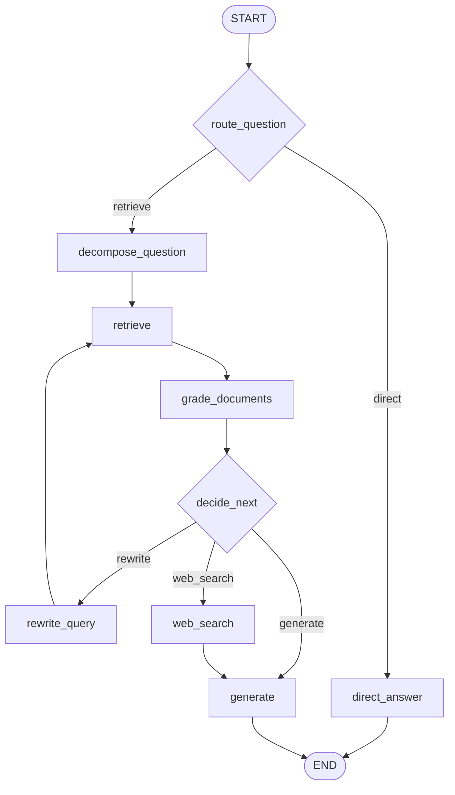

# 26 · Agentic RAG：基于 LangGraph 实现大模型自主决策的 RAG 闭环系统

> 这一章用 **Python 3.12 + LangChain Python + LangGraph + Pydantic** 把 RAG 做成闭环，并补齐 **离线可运行、评分节点、三重早停、可观测轨迹、依赖注入** 五项能力。

## 本章目标

1. 先写出传统线性 RAG 作为对照组，看清它「一视同仁检索、没有纠错、无法多跳」的五个问题；
2. 用 LangGraph 把「路由 → 拆解 → 检索 → 评分 → 决策 → 重写/联网 → 生成」编成一张带环的图；
3. 理解**条件边**（`add_conditional_edges`）如何把「模型的判断」变成「图的走向」；
4. 理解为什么必须有**预算闸门**：轮次上限、重写上限、分数停滞；
5. 得到一个断网、无 Key、无中间件也能完整跑通的 Agentic RAG 实现。

## 核心概念：Agentic RAG 到底是什么

传统 RAG 是一条直线：

```text
query ──► 向量化 ──► 相似度检索 ──► 拼接 prompt ──► 生成
```

它的问题很具体：

| 问题 | 表现 | 本章的解法 |
| --- | --- | --- |
| 所有问题都检索 | 寒暄也要查一次库，白白花 token | `route_question` 路由节点 |
| 没有评估纠错 | 检索错了也照答，直接幻觉 | `grade_documents` 评分节点 |
| 无法多步推理 | 「A 的儿子的父亲是谁」答不上 | `decompose_question` + 多跳循环 |
| 专有名词匹配不准 | 语义检索对实体/编号不敏感 | 换检索器即可（第 28 章 BM25） |
| 库里没有就瞎编 | 不会主动联网补充 | `web_search` 回退节点 |

**把「检索多少次、用什么检索、结果够不够、要不要重来」交给大模型自己决定，
并且用图把决策与执行串成闭环——这就是 Agentic RAG。**

本章的图：



注意 `rewrite → retrieve → grade → decide` 是一个**环**：这正是 LangGraph 相比 LCEL 链的核心价值——
链只能往前，图可以回头。

## 环境准备

```bash
cd python-agent-course
uv venv .venv --python 3.12
uv pip install -e .                 # 核心依赖（离线也要能跑）
uv pip install -e ".[graph]"        # 可选：langgraph（图编排）
cp .env.example .env                # 可选：填 OPENAI_API_KEY / OPENAI_BASE_URL
```

> **langgraph 是可选的**：未安装时自动切换到内置的 `MiniAsyncGraph`——
> 它与真图**共用同一份节点表与边表**（见 `graph.py` 的 `EDGES`），
> 实测 `strategy` / `retrieval_count` / `rewrite_count` / `answer` 与轨迹长度
> 和真 LangGraph 完全一致（`tests/test_ch25_graph_fallback.py` 对拍）。

可选：把检索器换成 Milvus、把联网节点换成博查/Tavily（本章代码里这两处都是**可替换实现**，
替换后节点与图不用改）：

```bash
uv pip install -e ".[rag]"          # pymilvus 等向量库依赖
docker compose -f chapters/ch27_docker_compose/docker-compose.dev.yml up -d standalone   # 拉起 Milvus
```

> **没有 API Key 也要能看懂链路**：配置缺失时 `build_chat_model()` 自动降级成离线 `EchoChatModel`，
> 本章的四个结构化决策（路由/拆解/评分/重写）会改走**内置启发式**，
> 检索走内存语料，联网走离线缓存。想强制离线：`OFFLINE=1`。

## 代码走查

### 1. `corpus.py` —— 把「外部数据源」变成可替换件

```python
@dataclass(slots=True, frozen=True)
class Passage:
    doc_id: str
    title: str
    chapter: int
    content: str
    source: str = "local"
```

常见写法是把 Milvus 连接放在**顶层 `await`**，任何一个中间件没起来脚本就崩。
本章把两处外部依赖抽成数据源常量：`PASSAGES`（本地语料）与 `WEB_CACHE`（离线缓存）。
配好环境后换成 `Milvus.from_documents(...)` 与博查 HTTP 调用即可，**节点代码零改动**。

### 2. `retrievers.py` —— 自己写一个能看懂的 BM25

```python
score += self.idf(term) * (freq * (K1 + 1)) / (freq + K1 * norm)
```

三行讲清 BM25 的三个策略：

- `freq * (K1+1) / (freq + K1*norm)`：词频**饱和**，堆砌关键词不再线性加分；
- `norm = 1 - b + b * dl / avgdl`：文档**长度归一化**，长片段不吃亏也不占便宜；
- `idf(term)`：**稀有词权重高**，「玄慈」比「的」更能决定相关性。

分词用二元组（bigram）：`神仙姐姐 → 神仙 / 仙姐 / 姐姐`，零依赖且对中文够用
（第 28 章会做带词典的完整分词 + 倒排索引）。完整的打分循环也就十几行：

```python
def search(self, query: str, k: int = 5) -> list[Retrieved]:
    """检索与查询最相关的 ``k`` 条片段。"""
    query_terms = terms(query)
    if not query_terms:
        return []
    scored: list[tuple[float, int]] = []
    for index, tokens in enumerate(self._tokenized):
        freq_map: dict[str, int] = {}
        for term in tokens:
            freq_map[term] = freq_map.get(term, 0) + 1
        length = self._lengths[index]
        norm = 1.0 - B + B * length / (self._avg_len or 1.0)
        score = 0.0
        for term in query_terms:
            freq = freq_map.get(term, 0)
            if freq == 0:
                continue
            score += self.idf(term) * (freq * (K1 + 1)) / (freq + K1 * norm)
        if score > 0:
            scored.append((score, index))
    scored.sort(key=lambda pair: pair[0], reverse=True)
    return [Retrieved(passage=self._passages[index], score=score, query=query) for score, index in scored[:k]]
```

三个必看的细节：`document_frequency` 用来判断"词库里到底有没有这个词"（路由的覆盖率靠它）；
`score > 0` 才入候选（无关片段不进结果）；返回的 `Retrieved` 带上了**产生它的那条 `query`**——
这正是多跳场景下 `chain_relevance` 能回溯"这条文档是哪一跳召回的"的原因。

### 3. `state.py` —— 用 Pydantic 描述「模型的输出契约」

```python
class GradeDecision(BaseModel):
    next_action: Literal["generate", "rewrite", "web_search"] = Field(
        description="generate=信息已足够；rewrite=换个问法重试；web_search=本地库覆盖不到"
    )
```

这份模型同时做三件事：生成给模型看的 JSON Schema、校验模型真的填对了、给 IDE 补全。
`description` 不是注释，是**给模型的 API 文档**——它同时进了 JSON Schema，
还顺手做了运行时校验。

状态（`AgenticRagState`）是 `TypedDict`，字段齐全、可序列化、可直接落日志：

```python
class AgenticRagState(TypedDict):
    question: str
    strategy: str
    sub_questions: list[str]
    next_sub_idx: int
    documents: list[Retrieved]
    graded: list[GradedDocument]
    retrieval_count: int  # 早停闸 1
    rewrite_count: int  # 早停闸 2
    next_action: str  # 条件边读它决定走向
    trace: list[str]  # 每一步决策，用于观测与回归
```

决策类模型都写清"每个取值意味着什么"，模型才可能填对：

```python
class RouteDecision(BaseModel):
    """路由节点的结构化输出：这个问题要不要走检索。"""

    strategy: Literal["direct", "retrieve"] = Field(
        description=(
            "direct=常识问答/简短定义，不需要查知识库；"
            "retrieve=需要具体情节、人物关系、章节事实等必须查库的事实"
        )
    )
    reason: str = Field(default="", description="一句话说明判断依据")


class Decomposition(BaseModel):
    """拆解节点的结构化输出：把多跳问题拆成可独立检索的有序子问题。"""

    sub_questions: list[str] = Field(
        default_factory=list,
        min_length=1,
        max_length=6,
        description="有序子问题，每条必须是可独立检索的完整问句，禁止出现他/她/此人等指代词",
    )
    reason: str = Field(default="", description="一句话说明拆解思路")
```

`min_length` / `max_length` 是**给模型的硬约束**，不是装饰——多跳问题最多拆 6 条，
超出就被 Pydantic 拦下。`description` 里明确"禁止代词"同样是"别让模型犯这个错"的直接手段。

### 4. `nodes.py` —— 七个节点与三道早停闸

节点写成**类的方法**而不是闭包工厂：

```python
class AgenticRagNodes:
    def __init__(self, deps: NodeDeps) -> None: ...

    async def decide_next(self, state: AgenticRagState) -> dict[str, Any]:
        exhausted = state["retrieval_count"] >= cfg.max_retrievals  # 闸 1
        no_more_rewrite = state["rewrite_count"] >= cfg.max_rewrites  # 闸 2
        plateau = state["retrieval_count"] >= 2 and not state["graded"] and remaining <= 0  # 闸 3
```

> 踩坑提醒：如果节点工厂返回类型写成 `Callable[[State], Awaitable[dict]]` 别名，
> mypy 无法把 `NodeInputT` 推断成 TypedDict，`graph.add_node` 会报
> `No overload variant matches`。写成类方法（或直接写模块级函数）就没这个问题。

两个关键设计：

**（a）结构化输出一定有兜底**

```python
async def structured(self, schema, system, user, fallback):
    if isinstance(self.deps.model, EchoChatModel):
        return fallback()  # 离线：走确定性规则
    try:
        raw = await self.deps.model.with_structured_output(schema).ainvoke(...)
        ...
    except Exception as exc:
        logger.warning("结构化输出失败（%s），改用启发式", exc)
    return fallback()
```

结构化输出一失败就抛错、整条图中断，是很多实现的默认行为。真实生产里，
模型偶发返回非法 JSON 是常态，**决策类调用必须可降级**。

节点用类方法还有一个直接好处：**依赖一次注入、方法可被单测直接调用**。

**（b）评分节点真的打分，且照顾多跳链路**

```python
def chain_relevance(self, question: str, hit: Retrieved) -> float:
    return max(self.relevance(question, hit), 0.7 * self.relevance(hit.query, hit))
```

多跳问题里第 1 跳的文档（「四大恶人排行」）与**原始问题**字面重合度天然偏低，
只按原始问题打分会被误杀、推理链断裂。所以取「与原始问题的相关性」和
「与召回到它的那条子问题的相关性 × 0.7」的较大值。

检索节点还有个容易被忽略的细节——**按 doc_id 去重合并**：

```python
async def retrieve(self, state: AgenticRagState) -> dict[str, Any]:
    """检索节点：按当前查询检索并按 doc_id 去重合并（同 id 保留高分）。"""
    query = state["current_query"] or state["question"]
    round_no = state["retrieval_count"] + 1
    hits = self.deps.retriever.search(query, k=self.deps.config.top_k)
    merged: dict[str, Retrieved] = {item.doc_id: item for item in state["documents"]}
    for hit in hits:
        previous = merged.get(hit.doc_id)
        if previous is None or hit.score > previous.score:
            merged[hit.doc_id] = hit
    documents = sorted(merged.values(), key=lambda item: item.score, reverse=True)
    return {
        "documents": documents,
        "retrieval_count": round_no,
        "queries_tried": state["queries_tried"] + [query],
        "best_score": max(state["best_score"], hits[0].score if hits else 0.0),
        "trace": state["trace"]
        + [f"retrieve[{round_no}] {query} → 新增 {len(hits)} 条 / 累计 {len(documents)} 条"],
    }
```

多跳一共检索好几轮，同一条文档会被反复召回。**不去重的话**评分节点的候选里会塞满重复项，
"相关片段数"虚高、`min_relevant` 判断失真，最后生成时同一段话被引用好几遍。
按 `doc_id` 合并、分数取高，是最简单也最正确的做法。

### 5. `graph.py` —— 把决策变成图的走向

```python
graph.add_conditional_edges(
    "decide_next",
    after_decide,
    {"rewrite": "rewrite_query", "web_search": "web_search", "generate": "generate"},
)
graph.add_edge("rewrite_query", "retrieve")  # 环：回去再检索一次
graph.add_edge("web_search", "generate")  # 联网后不再回头，避免死循环
```

除了节点内的三道闸门，调用侧还设了 `recursion_limit=40`：
这是**图级别的最后一道保险**，防止任何逻辑漏洞演变成无限循环烧钱。

### 6. `run_agentic_rag.py` —— 入口与分析

`run_agentic_rag.py` 是本章入口：装配依赖（模型 / 检索器 / 联网器）、`build_graph()`、
`ainvoke` 一次，然后把 `trace` 逐行打印出来。**它不含业务逻辑**，只是把可替换件接上，
所以换 Milvus 或换联网服务时，改动都集中在这里与 `nodes.py` 的组装点。

### 7. `naive_rag.py` —— 对照组

同一份语料、同一个检索器，跑线性流程做对比：

```text
问题：四大恶人排行第二的是谁？此人之子在身世揭晓前，其生父在武林中的公开身份是什么？
线性 RAG：检索 1 次 → 直接取最高分片段作答（只答出最后一跳，前两跳的推理过程缺失）
Agentic ：拆 3 条子问题 → 检索 3 轮 → 评分保留 4 条 → 生成（推理链完整）
```

### 9. `experiments.py` —— 把「决策闭环」跑成事实

这一章要验证的不是某个函数，而是**一整条决策链**：路由 → 拆解 → 检索 → 评分 →
决策 → 重写/联网 → 生成。`experiments.py` 把每个分叉都跑一遍：

```python
CONFIG = RunConfig(top_k=4, max_retrievals=4, max_rewrites=2)
DIRECT_QUESTION = "你好，请用一句话介绍你自己"
MULTI_HOP = "四大恶人排行第二的是谁？此人之子在身世揭晓前，其生父在武林中的公开身份是什么？"


async def _run(question: str) -> AgenticRagState:
    deps = build_deps(config=CONFIG)
    return await run_agentic_rag(question, deps=deps, config=CONFIG)
```

路由实验直接对比"常识"与"事实"两个问题：

```python
async def exp1_route_direct_vs_retrieve() -> ExperimentOutcome:
    direct = await _run(DIRECT_QUESTION)
    retrieve = await _run(SINGLE_HOP)
    return ExperimentOutcome(
        actual=f"常识→{direct['strategy']}（检索 {direct['retrieval_count']} 轮）；"
        f"事实→{retrieve['strategy']}（相关 {len(retrieve['graded'])} 条）",
        ok=direct["strategy"] == "direct" and direct["retrieval_count"] == 0,
    )
```

边表实验则证明"一套定义、两套执行器"：

```python
def exp7_edges_share_one_definition() -> ExperimentOutcome:
    # EDGES 同时喂给 StateGraph 与 MiniAsyncGraph
    rewrite_back = EDGES["rewrite_query"] == "retrieve"  # 唯一回边 = 循环
    conditional = [name for name, edge in EDGES.items() if isinstance(edge, tuple)]
    direct_branch = after_route({**initial_state(DIRECT_QUESTION), "strategy": "direct"})
    # 期望：direct→direct_answer、两处条件边、rewrite_query→retrieve 为唯一回边
```

它把六个最容易出事的点钉住：常识别白检索、多跳要拆、预算要早停、
本地不够要联网、df 才能判"库里有没有"、边表别写偏。
**为什么这章最该被跑**：Agentic RAG 的所有价值都在"路径"上，
读代码只会看到一堆节点函数，跑一遍才能看清"它到底会不会走错路"。

## 运行

```bash
cd python-agent-course
# 完整闭环（离线可跑）：三个问题分别演示 direct / 单跳 / 多跳
uv run python -m chapters.ch26_agentic_rag.run_agentic_rag
# 指定问题
uv run python -m chapters.ch26_agentic_rag.run_agentic_rag "阿朱的结局是什么？"
# 对照组：传统线性 RAG（同一份语料、同一个检索器）
uv run python -m chapters.ch26_agentic_rag.naive_rag
```

> 无 Key 时四个结构化决策（路由/拆解/评分/重写）改走**内置启发式**，
> 检索走内存语料，联网走离线缓存。未装 langgraph 时会切到 `MiniAsyncGraph`（节点与边完全一致）。

### 输出 · `run_agentic_rag`（Agentic 闭环）

<!-- run: chapters.ch26_agentic_rag.run_agentic_rag -->
```text
（图结构 Mermaid 见 README，终端输出省略以避免刷屏）

━━━ 问题 1 你好，请用一句话介绍你自己
           INFO     路由：direct（语料词项覆盖率 0.10）
           INFO     闭环结束：策略=direct 检索轮次=0 重写=0 相关片段=0
策略 direct（语料词项覆盖率 0.10）
决策轨迹
  · route_question → direct（语料词项覆盖率 0.10）
  · direct_answer → 未检索，直接作答
检索轮次 0 / 重写 0 / 相关片段 0
回答 [离线·直接回答] 该问题未命中知识库词项，判定为常识类问题，未调用检索。问题：你好，请用一句话介绍你自己

━━━ 问题 2 阿朱的结局是什么？
           INFO     路由：retrieve（语料词项覆盖率 0.57）
           INFO     拆解出 1 条子问题：['阿朱的结局是什么？']
           INFO     第 1 轮检索 '阿朱的结局是什么？'：新增 4 条，累计 4 条
           INFO     评分：4 条候选，保留 3 条（阈值 0.18，最高 0.45）
           INFO     决策：generate（已有高相关片段）
           INFO     闭环结束：策略=retrieve 检索轮次=1 重写=0 相关片段=3
策略 retrieve（语料词项覆盖率 0.57）
子问题
  1. 阿朱的结局是什么？
决策轨迹
  · route_question → retrieve（语料词项覆盖率 0.57）
  · decompose_question → 1 条子问题（单跳问题，无需拆解）
  · retrieve[1] 阿朱的结局是什么？ → 新增 4 条 / 累计 4 条
  · grade_documents → 保留 3/4 条相关文档
  · decide_next → generate（已有高相关片段；轮次 1/4）
  · generate → 生成最终回答
检索轮次 1 / 重写 0 / 相关片段 3
回答 依据知识库片段：乔峰误以为段正淳是杀父仇人（阿朱的结局 · tlbb-07）；阿朱是段正淳与阮星竹的女儿（阿朱的身世 · tlbb-06）。

━━━ 问题 3 四大恶人排行第二的是谁？此人之子在身世揭晓前，其生父在武林中的公开身份是什么？
           INFO     路由：retrieve（语料词项覆盖率 0.58）
           INFO     拆解出 3 条子问题：['四大恶人排行第二的是谁', '此人之子在身世揭晓前', '其生父在武林中的公开身份是什么']
           INFO     第 1 轮检索 '四大恶人排行第二的是谁'：新增 3 条，累计 3 条
           INFO     评分：3 条候选，保留 2 条（阈值 0.18，最高 0.40）
           INFO     决策：rewrite（还有未检索的子问题）
           INFO     重写查询：此人之子在身世揭晓前
           INFO     第 2 轮检索 '此人之子在身世揭晓前'：新增 4 条，累计 5 条
           INFO     评分：5 条候选，保留 4 条（阈值 0.18，最高 0.40）
           INFO     决策：rewrite（还有未检索的子问题）
           INFO     重写查询：其生父在武林中的公开身份是什么
           INFO     第 3 轮检索 '其生父在武林中的公开身份是什么'：新增 3 条，累计 6 条
           INFO     评分：6 条候选，保留 4 条（阈值 0.18，最高 0.45）
           INFO     决策：generate（已有高相关片段）
           INFO     闭环结束：策略=retrieve 检索轮次=3 重写=2 相关片段=4
策略 retrieve（语料词项覆盖率 0.58）
子问题
  1. 四大恶人排行第二的是谁
  2. 此人之子在身世揭晓前
  3. 其生父在武林中的公开身份是什么
决策轨迹
  · route_question → retrieve（语料词项覆盖率 0.58）
  · decompose_question → 3 条子问题（按标点切分子句（离线规则））
  · retrieve[1] 四大恶人排行第二的是谁 → 新增 3 条 / 累计 3 条
  · grade_documents → 保留 2/3 条相关文档
  · decide_next → rewrite（还有未检索的子问题；轮次 1/4）
  · rewrite_query → 此人之子在身世揭晓前（改用下一条子问题）
  · retrieve[2] 此人之子在身世揭晓前 → 新增 4 条 / 累计 5 条
  · grade_documents → 保留 4/5 条相关文档
  · decide_next → rewrite（还有未检索的子问题；轮次 2/4）
  · rewrite_query → 其生父在武林中的公开身份是什么（改用下一条子问题）
  · retrieve[3] 其生父在武林中的公开身份是什么 → 新增 3 条 / 累计 6 条
  · grade_documents → 保留 4/6 条相关文档
  · decide_next → generate（已有高相关片段；轮次 3/4）
  · generate → 生成最终回答
检索轮次 3 / 重写 2 / 相关片段 4
回答 依据知识库片段：虚竹本是少林寺中一名最寻常的小和尚（叶二娘与虚竹的身世 · tlbb-05）；段誉是大理镇南王段正淳的世子（段誉的家世与结局 · tlbb-12）。

━━━ 问题 4 《天龙八部》2013 版电视剧里，雁门关事件主要出现在哪几集？
           INFO     路由：retrieve（语料词项覆盖率 0.25）
           INFO     拆解出 2 条子问题：['《天龙八部》2013 版电视剧里', '雁门关事件主要出现在哪几集']
           INFO     第 1 轮检索 '《天龙八部》2013 版电视剧里'：新增 1 条，累计 1 条
           INFO     评分：1 条候选，保留 0 条（阈值 0.18，最高 0.07）
           INFO     决策：rewrite（还有未检索的子问题）
           INFO     重写查询：雁门关事件主要出现在哪几集
           INFO     第 2 轮检索 '雁门关事件主要出现在哪几集'：新增 2 条，累计 3 条
           INFO     评分：3 条候选，保留 1 条（阈值 0.18，最高 0.18）
           INFO     决策：web_search（本地库覆盖不足，尝试联网补充）
           INFO     联网回退（离线缓存）：雁门关事件主要出现在哪几集
           INFO     闭环结束：策略=retrieve 检索轮次=2 重写=1 相关片段=1
策略 retrieve（语料词项覆盖率 0.25）
子问题
  1. 《天龙八部》2013 版电视剧里
  2. 雁门关事件主要出现在哪几集
决策轨迹
  · route_question → retrieve（语料词项覆盖率 0.25）
  · decompose_question → 2 条子问题（按标点切分子句（离线规则））
  · retrieve[1] 《天龙八部》2013 版电视剧里 → 新增 1 条 / 累计 1 条
  · grade_documents → 保留 0/1 条相关文档
  · decide_next → rewrite（还有未检索的子问题；轮次 1/4）
  · rewrite_query → 雁门关事件主要出现在哪几集（改用下一条子问题）
  · retrieve[2] 雁门关事件主要出现在哪几集 → 新增 2 条 / 累计 3 条
  · grade_documents → 保留 1/3 条相关文档
  · decide_next → web_search（本地库覆盖不足，尝试联网补充；轮次 2/4）
  · web_search → 50 字符补充上下文
  · generate → 生成最终回答
检索轮次 2 / 重写 1 / 相关片段 1
联网补充 [离线网页缓存] 改编信息：不同版本的电视剧对雁门关事件的分集处理不同，请以上映平台的剧集列表为准。…
回答 依据知识库片段：三十年前的雁门关血案（雁门关事件 · tlbb-08）。
```

### 输出 · `naive_rag`（线性 RAG 对照组）

<!-- run: chapters.ch26_agentic_rag.naive_rag -->
```text
问题 阿朱的结局是什么？
检索命中 4 条：
  · 阿朱的结局（8.294）
  · 阿朱的身世（5.243）
  · 慕容复的结局（3.690）
回答 [离线·线性 RAG]
直接取最高分片段作答：乔峰误以为段正淳是杀父仇人，约战于小镜湖。阿朱得知乔峰要杀段正淳，于是易容成段正淳赴约，代父受死，被乔峰一掌击中天灵而死。阿朱临死前托乔峰照顾妹妹阿紫。（阿朱的结局 · tlbb-07）

问题 四大恶人排行第二的是谁？此人之子在身世揭晓前，其生父在武林中的公开身份是什么？
检索命中 4 条：
  · 叶二娘与虚竹的身世（28.250）
  · 段誉的家世与结局（13.241）
  · 四大恶人（11.448）
回答 [离线·线性 RAG]
直接取最高分片段作答：虚竹本是少林寺中一名最寻常的小和尚，自幼在寺中长大。身世揭晓时才知道，虚竹的生母是四大恶人中的叶二娘，生父是少林寺的玄慈；玄慈在武林中的公开身份是少林寺方丈，他与叶二娘的私情一直
未被外人知晓。（叶二娘与虚竹的身世 · tlbb-05）

问题 你好，请用一句话介绍你自己
检索命中 2 条：
  · 乔峰的身世（1.999）
  · 段誉的家世与结局（1.927）
回答 [离线·线性 RAG] 直接取最高分片段作答：乔峰本是汉人养父母养大的丐帮帮主，身世揭晓后才知道自己本名萧峰，是契丹人萧远山之子，生母在雁门关一役中被中原群豪所杀。（乔峰的身世 · tlbb-10）

观察点：线性流程对所有问题一视同仁地检索；多跳问题只检索一次就作答（漏掉第二跳）；常识问题也要白白检索一次。
```

**两组输出一比，闭环补了什么就清楚了：**

| | naive（线性） | agentic（闭环） |
| --- | --- | --- |
| 寒暄问题 | **也检索了 2 条**（浪费） | `direct`，检索 0 次 |
| 单跳问题 | 检索 1 次 | 检索 1 次，但**评分筛掉 1 条噪声**（4→3） |
| 多跳问题 | **只检索 1 次**，直接答（漏第二跳） | 拆 3 条子问题、**检索 3 轮**、重写 2 次 |
| 覆盖 | 单词面最高分 | 三轮累计 6 条、保留 4 条 |

注意 naive 在寒暄问题上命中「乔峰的身世」「段誉的家世」（分数 1.999/1.927，
只是**碰巧有字面重合**），然后一本正经地答了乔峰的身世——
**这就是"所有问题都检索"的具体代价：不该查的查了，还答偏了。**

### 输出 · `experiments`

一行命令看结论（`--summary`）：

```bash
uv run python -m chapters.ch26_agentic_rag.experiments --summary
```

<!-- run: chapters.ch26_agentic_rag.experiments -->
```text
共 7 个实验，断言通过 7，失败 0

[1] 路由：常识直答 / 事实检索      → 断言通过（direct_retrievals=0）
[2] 多跳问题被拆成有序子问题       → 断言通过（sub_questions=3）
[3] 预算闸门触发早停               → 断言通过（single_retrievals=1）
[4] 本地覆盖不足则联网回退         → 断言通过（web_context_len=50）
[5] 检索器是 BM25-lite 且 df 可判空 → 断言通过（tokens=3，known_df=2）
[6] 线性 RAG 对照                  → 断言通过（naive_docs=4）
[7] 边表是单一事实来源             → 断言通过（conditional_edges=2）
```

## 动手实验

每条实验都是**一条命令 + 实测现象**：跑 `python -m chapters.ch26_agentic_rag.experiments --exp N`
就能自己看到，不用改文件。想看全部，用 `--all`。

### 实验 1：路由：常识直答 / 事实检索

```bash
python -m chapters.ch26_agentic_rag.experiments --exp 1
```

| 项 | 值 |
| --- | --- |
| 改了什么 | 分别用常识问题与事实问题跑闭环，看 `strategy` 与检索轮次 |
| 期望现象 | 常识走 `direct` 且不检索；事实走 `retrieve` |
| 实测 | 常识 → `direct`、检索 0 轮；事实 → `retrieve`、相关片段 3 条 |

**为什么**：不是所有问题都该查库。寒暄、定义类问题白白检索一次，既慢又可能被噪声片段带偏——路由省下的是一次检索 + 一次生成前的拼装。

### 实验 2：多跳问题被拆成有序子问题

```bash
python -m chapters.ch26_agentic_rag.experiments --exp 2
```

| 项 | 值 |
| --- | --- |
| 改了什么 | 用复合问题跑闭环，统计子问题数与检索轮次 |
| 期望现象 | 拆出多条第子问题，检索多轮 |
| 实测 | 3 条子问题、检索 3 轮、重写 2 次；单跳问题仅 1 条子问题 |

**为什么**：多跳问题的答案在前置实体的下一跳里，**只检索一次必然漏掉后面几跳**。而「有序」很关键——先查前置实体，才能用它的名字去查结论。

### 实验 3：预算闸门触发早停

```bash
python -m chapters.ch26_agentic_rag.experiments --exp 3
```

| 项 | 值 |
| --- | --- |
| 改了什么 | 看命中足够与覆盖不足两类问题的 `next_action` 与检索轮次 |
| 期望现象 | 命中足够转 `generate`；检索轮次不超过 `max_retrievals` |
| 实测 | 单跳保留 3 条后转 `generate`，共 1 轮；覆盖不足走 2 轮后转 `web_search` |

**为什么**：`decide_next` 有三道早停闸（轮次、重写、预算）。**模型的自由裁量不能突破预算闸门**——代码里先算 `exhausted`，为真就强制 `generate`。

### 实验 4：本地覆盖不足则联网回退

```bash
python -m chapters.ch26_agentic_rag.experiments --exp 4
```

| 项 | 值 |
| --- | --- |
| 改了什么 | 用 2013 版电视剧问题跑闭环 |
| 期望现象 | 产生 `web_context`，且 `web_search` 单向到 `generate` |
| 实测 | trace 出现 `decide_next → web_search`、`web_search → 50 字符补充上下文` |

**为什么**：边表里 `web_search → generate` 是**单向**的，联网后不再回头，避免「联网 ↔ 检索」相互触发形成无限循环。知道「什么时候该承认本地不够、去外面找」，是 Agentic 与普通 RAG 的分水岭。

### 实验 5：检索器是 BM25-lite 且 df 可判空

```bash
python -m chapters.ch26_agentic_rag.experiments --exp 5
```

| 项 | 值 |
| --- | --- |
| 改了什么 | 检查 `terms` 切词、`document_frequency` 与无关查询 |
| 期望现象 | 二元组切词；相关词 `df>0`、无关词 `df=0`；无关查询返回空 |
| 实测 | `terms('神仙姐姐')=['神仙','仙姐','姐姐']`；`df('阿朱')=2`、`df('上市')=0` |

**为什么**：判断「这个词库里到底有没有」要用 `document_frequency`，**不能拿 idf**——idf 对语料里没有的词返回一个正的小值，看起来像「有」。这是容易被 idf 骗到的点。

### 实验 6：线性 RAG 对照

```bash
python -m chapters.ch26_agentic_rag.experiments --exp 6
```

| 项 | 值 |
| --- | --- |
| 改了什么 | 用同一依赖跑对照组的三个问题 |
| 期望现象 | 线性 RAG 对多跳只检索一次、对常识仍检索 |
| 实测 | 多跳检索 4 条即作答；常识仍检索 4 条；Agentic 对常识检索 0 次 |

**为什么**：线性流程**一步不多、一步不少**——多跳漏第二跳、常识白检索。Agentic 用多出来的决策步骤换准确率，代价是更复杂、更慢、更贵——**它不是免费的升级，而是用成本换准确率的选择**。

### 实验 7：边表是单一事实来源

```bash
python -m chapters.ch26_agentic_rag.experiments --exp 7
```

| 项 | 值 |
| --- | --- |
| 改了什么 | 检查 `EDGES` 的回边、终点与两个条件路由 |
| 期望现象 | `rewrite_query→retrieve` 为唯一回边；两处条件边返回正确分支 |
| 实测 | 唯一回边 = True；条件边 `['route_question','decide_next']`；`after_decide(rewrite)→rewrite` |

**为什么**：`EDGES` 同时喂给 `StateGraph` 与 `MiniAsyncGraph`——**一份定义、两套执行器**，所以「装了 langgraph 一个样、没装另一个样」这种最坑人的不一致根本不可能发生。

## 本章的工程化取舍

| 常见做法 | 本章做法 | 收益 |
| --- | --- | --- |
| 4 个脚本逐个复制演进（naive → router → multihop → webfallback） | 一张图 + `RunConfig` 开关（`web_enabled`/`max_retrievals`） | 不用复制代码，改参数就能复现四种形态 |
| 顶层 `await Milvus.fromExistingCollection(...)` | `InMemoryRetriever` 兜底 + 依赖注入 | 无中间件也能跑通；换 Milvus 只改组装点 |
| `while` 循环靠模型自觉结束 | 轮次上限 + 重写上限 + 分数停滞 + `recursion_limit` | 四道闸门，杜绝死循环烧 token |
| 评估只有 `enough: boolean` | 每条文档 0~1 相关性分 + 阈值过滤 + 多跳链路加权 | 能去噪、能解释「为什么保留它」 |
| `console.log` 打印中间结果 | `trace: list[str]` 逐步记录 + `logging` | 可落盘做回归测试，也方便接 LangSmith |
| 结构化输出失败即抛错 | `structured()` 异常降级到启发式 | 模型偶发输出非法 JSON 时链路不中断 |
| `Annotation.Root({...})` 无类型 | `TypedDict` + `mypy --strict` | 状态字段拼错在编译期就暴露 |
| 联网搜索 Key 缺失直接 throw | `OfflineWebSearcher` 缓存兜底并明确标注来源 | 生成节点不会把缓存内容误当作知识库原文 |
| 无 | `naive_rag.py` 对照组 | 用同一份语料量化「闭环到底补了什么」 |

## 最佳实践清单

- **数据源要可替换**：检索器 / 联网器写成接口，示例用内存实现，生产换 Milvus / 博查。
- **决策必须有预算**：`max_retrievals`、`max_rewrites`、`recursion_limit`，一个都不能少。
- **模型的自由裁量不能突破硬规则**：先让模型给建议，再用规则兜底（如本模块的 `exhausted` 覆盖）。
- **评分要考虑查询归属**：多跳场景下「文档 vs 原始问题」的分数会低估链路文档。
- **结构化输出要可降级**：决策类调用失败时退回规则，而不是让整条图崩掉。
- **状态要可序列化**：方便落日志、做回放、接观测平台。

## 常见坑 / 排错

1. **`add_node` 报 `No overload variant matches`**：节点函数别用 `Callable` 类型别名，
   直接写模块级 `async def` 或类方法。
2. **`InvalidUpdateError: expected node ... to update at least one of [...]`**：
   节点返回了状态里不存在的 key，或返回的 dict 为空。检查 `TypedDict` 字段是否漏加。
3. **图跑不出来、一直循环**：确认 `decide_next` 的硬规则分支生效；
   同时给 `ainvoke` 传 `{"recursion_limit": N}`。
4. **离线模式所有问题都走 direct**：检查 `ROUTE_COVERAGE_MIN`，
   语料太小或分词太粗会让覆盖率偏低，可调阈值或换分词。
5. **多跳只走了一跳就结束**：确认 `next_sub_idx` 的语义是「下一条**待检索**子问题」，
   拆解后应初始化为 `1`（第 0 条已写入 `current_query`）。
6. **真实模型下 `with_structured_output` 报 schema 不支持**：改用
   `model.bind_tools([...])` + `tool_choice`，或用 `JsonOutputParser`。

## 延伸练习

1. 把 `RunConfig.web_enabled=False`，观察同一个问题从「联网补充」变成「基于现有片段作答」。
2. 把 `max_retrievals` 改成 1，重跑多跳问题，体会「早停闸门」对成本与质量的影响。
3. 给 `InMemoryRetriever` 换成 Milvus（或第 28 章的 BM25），对比同一批问题的召回差异。

## 小结

Agentic RAG 的本质不是「多调几次检索」，而是**把检索的控制权交给模型，同时用工程手段给这个控制权装上预算与刹车**：
路由决定要不要查、拆解决定分几步查、评分决定查到的是不是垃圾、决策决定要不要再来一轮、
联网决定本地不够时去哪补。下一章我们把这些依赖的中间件（MySQL / Milvus / ES）
用 **Docker Compose** 一键编排起来，让本地开发与生产部署不再靠手动点 Docker Desktop。
