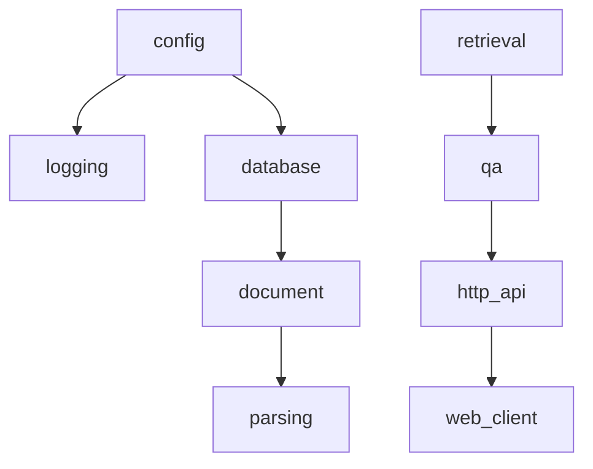

# 48 · 企业级知识库项目总览：模块划分、多模态 RAG 流程与技术选型

> 这一章是项目总览：讲模块划分、多模态 RAG 流程与技术选型。

## 本章目标

1. 能把模块划分与依赖关系**数据化**，并自动检查循环依赖与反向依赖；
2. 理解为什么"架构约束"必须写成代码而不是文档；
3. 能把 RAG 流水线描述成**阶段规格表**（产出 / 失败模式 / 兜底）；
4. 能把技术选型从"我觉得"变成"打分 × 权重"，让分歧可讨论。

## 核心概念：三件可执行化的事

```text
① 模块清单（MODULE registry）
   └─► dependency_graph() ──► detect_cycles()      环检测
                           └─► check_layer_rule()  反向依赖检测
                           └─► to_mermaid()        文档与代码同源

② RAG 流水线（PIPELINE: tuple[StageSpec, ...]）
   └─► pipeline_table()   产出 / 失败模式 / 兜底 三列表

③ 选型矩阵（Option × Criterion）
   └─► decide() → render_decision()   加权总分排序
```

## 环境准备

```bash
# 项目根目录，一次装齐核心依赖（langchain-core / pydantic / rich 等）
uv venv .venv --python 3.12        # Windows: py -3.12 -m venv .venv
uv pip install -e .
cp .env.example .env               # 需要真实模型时填 OPENAI_API_KEY / OPENAI_BASE_URL
```

> **没有 API Key 也能跑**：`build_chat_model()` 在缺 Key 或 `OFFLINE=1` 时自动降级为离线
> `EchoChatModel`，链路完整走一遍。测试与 CI 一律强制 `OFFLINE=1`。

本章是架构总览与依赖检查，**不需要额外依赖**。

## 代码走查：`overview.py`

项目总览最容易写成"PPT 文字"。本章把三件事**可执行化**：架构约束、流水线、选型。

### 1. 分层：为什么要单独拆出 FOUNDATION

```python
class Layer(IntEnum):
    """分层。数值越小越底层。**依赖只能从高层指向低层**。

    为什么要单独拆出 ``FOUNDATION``：配置与日志被所有基础设施模块依赖，
    如果它们和数据库/MQ 同层，就会触发"不允许同层依赖"的告警——
    这不是违规，而是**分层粒度不够**。粒度不够就该加层，而不是放宽规则。
    """

    FOUNDATION = 0  # 地基：配置、日志
    INFRA = 1  # 基础设施：数据库、对象存储、MQ、向量库、图库、检索
    DOMAIN = 2  # 领域层：文档、权限、审核、租户
    SERVICE = 3  # 服务层：解析、检索、问答、抽取
    API = 4  # 接口层：HTTP 路由、SSE、回调
    CLIENT = 5  # 接入层：Web、小程序、OpenAPI 客户端
```

最初我把 `config` 和数据库放在同一层，结果"不允许同层依赖"的告警打了 5 条——
但这**不是违规，是分层粒度不够**。

> **遇到规则告警时的正确反应**：先问"是规则太粗，还是代码错了"。
> 这里答案是前者，于是加了一层，而不是放宽规则。

### 2. 架构是数据：模块表

模块本身是纯数据，一张表就能说清"谁依赖谁、谁在哪层"：

```python
@dataclass(frozen=True, slots=True)
class Module:
    """一个模块。

    Attributes:
        name: 模块名。
        layer: 所属层。
        depends: 依赖的模块名。
        duty: 职责（一句话）。
    """

    name: str
    layer: Layer
    depends: tuple[str, ...]
    duty: str


MODULES: Final[tuple[Module, ...]] = (
    Module("config", Layer.FOUNDATION, (), "配置与密钥：pydantic-settings + 环境变量"),
    Module("logging", Layer.FOUNDATION, ("config",), "结构化日志与控制台输出"),
    Module("database", Layer.INFRA, ("config",), "PostgreSQL 连接与会话管理（SQLAlchemy 2.0）"),
    Module("object_store", Layer.INFRA, ("config",), "对象存储：预签名上传、回调校验、分片"),
    Module("vector", Layer.INFRA, ("config",), "向量库：Milvus / pgvector 适配"),
    Module("document", Layer.DOMAIN, ("database", "object_store"), "文档元数据、版本与状态机"),
    Module("tenant", Layer.DOMAIN, ("database",), "租户隔离与配额"),
    Module(
        "retrieval", Layer.SERVICE, ("vector", "search", "graph_store", "document"), "混合检索与 RRF 融合"
    ),
    Module("qa", Layer.SERVICE, ("retrieval", "document", "logging"), "问答编排：改写、重排、生成、引用"),
    Module("http_api", Layer.API, ("auth", "qa", "document", "parsing"), "HTTP 路由与 SSE 流式输出"),
    Module("web_client", Layer.CLIENT, ("http_api",), "Web 前端与小程序"),
)


def find_module(name: str) -> Module:
    """按名取模块；不存在抛 ``KeyError``。"""
    for module in MODULES:
        if module.name == name:
            return module
    raise KeyError(name)


def dependency_graph() -> dict[str, list[str]]:
    """构建邻接表（模块 → 它依赖的模块）。"""
    return {module.name: list(module.depends) for module in MODULES}
```

### 3. 反向依赖 vs 同层依赖

有了这份数据，"架构合规"就可以**跑一遍检查**，而不是读文档：

```python
def check_layer_rule() -> list[str]:
    """检查"**不允许反向依赖**"（低层依赖高层）。

    为什么只禁反向、不禁同层：同层模块互相依赖在真实工程里很常见
    （``qa`` 依赖 ``retrieval``、``http_api`` 依赖 ``auth``），
    一刀切禁止会导致没人遵守，规则就废了。
    **反向依赖才是真正的架构腐化**——它意味着"底层知道了上层的存在"。
    """
    violations: list[str] = []
    for module in MODULES:
        for dependency in module.depends:
            target = find_module(dependency)
            if target.layer > module.layer:
                violations.append(
                    f"{module.name}(L{int(module.layer)}) 反向依赖 {target.name}(L{int(target.layer)})"
                )
    return violations
```

**为什么不禁止同层依赖**：同层模块互相依赖在真实工程里非常常见
（`qa` 依赖 `retrieval`、`http_api` 依赖 `auth`）。
一刀切禁止会导致没人遵守，规则就废了。
**反向依赖才是真正的架构腐化**——它意味着"底层知道了上层的存在"。
同层依赖不报错，但值得定期 review：数量变多通常说明该抽一层了。

### 4. 环检测：DFS 三色标记

```python
def detect_cycles(graph: dict[str, list[str]]) -> list[list[str]]:
    """DFS 三色标记检测环。

    **为什么必须自动化检查环**：架构文档里写"不能有循环依赖"，
    三个月后一定会被打破——加一个"图数据库模块要读文档模块"就成环了。
    写成断言，CI 会拦住它。

    Returns:
        环列表（每个环是节点名序列，首尾相接）。
    """
    #: 三色标记是算法惯用名，保持大写比改成小写更易读
    white, gray, black = 0, 1, 2
    color = dict.fromkeys(graph, white)
    stack: list[str] = []
    cycles: list[list[str]] = []

    def visit(node: str) -> None:
        color[node] = gray
        stack.append(node)
        for nxt in graph.get(node, ()):
            if color.get(nxt, white) == gray:
                cycles.append([*stack[stack.index(nxt) :], nxt])
            elif color.get(nxt, white) == white:
                visit(nxt)
        stack.pop()
        color[node] = black

    for node in graph:
        if color[node] == white:
            visit(node)
    return cycles
```

`white`（未访问）/ `gray`（在栈上）/ `black`（已完成）三色标记是标准做法：
**遇到 GRAY 节点就是找到了一个环**。真实依赖图（19 模块 / 33 条边）检出 0 处环；
实验 2 会注入一个 `a→b→c→a` 让你看到它确实报得出来。

### 5. 分层视图：最长路径深度

```python
def topological_layers(graph: dict[str, list[str]]) -> list[tuple[int, list[str]]]:
    """按"最长路径深度"分层（同层可并行开发/部署）。

    Returns:
        ``(深度, 模块名列表)``，按深度升序。
    """
    depth: dict[str, int] = {}

    def resolve(node: str) -> int:
        if node in depth:
            return depth[node]
        depth[node] = 0  # 防御：成环时避免无限递归
        depends = graph.get(node, ())
        depth[node] = 0 if not depends else max(resolve(item) + 1 for item in depends)
        return depth[node]

    for node in graph:
        resolve(node)
    grouped: dict[int, list[str]] = {}
    for node, value in depth.items():
        grouped.setdefault(value, []).append(node)
    return sorted(grouped.items())
```

```text
深度 0：config
深度 1：database, graph_store, logging, mq, object_store, search, vector
深度 2：audit, document, rbac, tenant
深度 3：auth, extraction, parsing, retrieval
深度 4：qa
深度 5：http_api
深度 6：web_client
```

同深度的模块没有依赖关系，可以**并行开发、并行部署**——这是排期时能直接用的信息。
注意 `resolve()` 里**先写 `depth[node] = 0` 再递归**：这是成环时的防御，
避免无限递归。`detect_cycles()` 负责报环，这个函数不该崩。

文档与代码同源，靠 `to_mermaid()` 导出流程图：

```python
def to_mermaid(graph: dict[str, list[str]]) -> str:
    """导出 mermaid 流程图（**文档与代码同源**，改代码文档自动跟着变）。"""
    lines = ["```mermaid", "graph TD"]
    for node, depends in graph.items():
        for dependency in depends:
            lines.append(f"    {dependency} --> {node}")
    lines.append("```")
    return "\n".join(lines)
```

### 6. 流水线：每个阶段都要写"兜底"

流水线是**数据**，不是图。每个阶段都带"失败模式 + 兜底"：

```python
@dataclass(frozen=True, slots=True)
class StageSpec:
    """一个阶段的规格：输入、输出、失败模式与兜底。"""

    stage: Stage
    produces: str
    failure_mode: str
    fallback: str


PIPELINE: Final[tuple[StageSpec, ...]] = (
    StageSpec(Stage.UPLOAD, "原始文件 + 元数据", "大文件超时、回调伪造", "分片上传 + HMAC 回调校验"),
    StageSpec(Stage.PARSE, "Markdown + 图片", "扫描版 PDF 无文字层", "OCR 兜底 + 标记为低置信度"),
    StageSpec(Stage.CHUNK, "带元数据的 chunk", "表格/图片被切断", "按结构边界切 + 保留表格整体"),
    StageSpec(Stage.EMBED, "向量", "超长被截断、批量限流", "超长分段再池化 + 指数退避重试"),
    StageSpec(Stage.INDEX, "可检索索引", "写入部分成功", "幂等写入（按内容 hash 去重）"),
    StageSpec(Stage.RETRIEVE, "候选片段", "术语 vs 语义单一路线漏召", "BM25 + 向量双路 + RRF"),
    StageSpec(Stage.RERANK, "排序后的片段", "重排模型耗时高", "只对 top-20 重排 + 超时降级"),
    StageSpec(Stage.GENERATE, "回答草稿", "模型超时/超预算", "流式输出 + 预算上限 + 降级小模型"),
    StageSpec(Stage.CITE, "带引用的回答", "引用与正文不符", "逐句校验，无支撑则降级为拒答"),
)


def pipeline_table() -> str:
    """渲染流水线 Markdown 表。"""
    header = "| 阶段 | 产出 | 典型失败 | 兜底策略 |\n| --- | --- | --- | --- |"
    rows = [
        f"| {item.stage.value} | {item.produces} | {item.failure_mode} | {item.fallback} |"
        for item in PIPELINE
    ]
    return "\n".join([header, *rows])
```

**"典型失败 + 兜底"这两列才是流水线的价值所在**。
只画流程图的流水线在真实数据面前一天都撑不住；
把失败模式写进数据结构，它就成了**故障预案清单**。

### 7. 选型：把分歧变成数字

加权矩阵的实现就十行，**关键是权重显式在 `Criterion` 里**：

```python
@dataclass(frozen=True, slots=True)
class Criterion:
    """一个评分维度。"""

    name: str
    weight: float
    higher_is_better: bool = True


@dataclass(frozen=True, slots=True)
class Option:
    """一个候选方案：各维度原始分（0-10）。"""

    name: str
    scores: dict[str, float]
    note: str = ""


def decide(options: list[Option], criteria: list[Criterion]) -> list[tuple[str, float, dict[str, float]]]:
    """加权决策。

    **为什么要把选型做成打分表**：技术选型 90% 的分歧其实是**权重分歧**——
    运维说"运维成本最重要"，业务说"上线速度最重要"。
    把权重显式写成一个列表，分歧就从"我觉得"变成"权重该给多少"，
    可讨论、可留痕、可复盘。
    """
    results: list[tuple[str, float, dict[str, float]]] = []
    for option in options:
        contribution = {item.name: option.scores.get(item.name, 0.0) * item.weight for item in criteria}
        results.append((option.name, round(sum(contribution.values()), 2), contribution))
    results.sort(key=lambda row: -row[1])
    return results
```

```text
| 方案          | 运维成本 | 性能  | 生态  | 成本  | 团队熟悉度 | 总分  |
| pgvector      | 2.70    | 1.50 | 1.60 | 1.35 | 0.90     | 8.05 |
| Elasticsearch | 1.80    | 1.75 | 1.80 | 0.90 | 0.70     | 6.95 |
| Milvus        | 1.20    | 2.50 | 1.80 | 0.75 | 0.50     | 6.75 |
```

**技术选型 90% 的分歧其实是权重分歧**：运维说"运维成本最重要"，
业务说"上线速度最重要"。把权重显式写成一个 `Criterion` 列表，
分歧就从"我觉得"变成"这个权重该给多少"——可讨论、可留痕、可复盘。
实验 6 会只用两组不同权重，让 pgvector 和 Milvus 换位。

结论：**先把 pgvector 用起来**。当数据量过千万或需要多租户物理隔离时，
再拿同一张表、新的权重重新打分。**决策要能重跑，不要一次定终身**。

### 8. `experiments.py` —— 把架构约束做成命令

本章的六个实验是 `experiments.py` 里的 `Experiment(名字, 改什么, 期望, run)`，
**用"改后的参数再跑一次纯函数"，绝不改仓库文件**：

```bash
python -m chapters.ch48_kb_project_intro.experiments --list   # 看有哪些实验
python -m chapters.ch48_kb_project_intro.experiments --exp 3  # 只跑第 3 个（反向依赖）
python -m chapters.ch48_kb_project_intro.experiments --all    # 全跑并汇总断言
```

```python
def exp3_reverse_dependency_violation() -> ExperimentOutcome:
    """反向依赖（低层依赖高层）会被判违规。"""
    baseline = check_layer_rule()
    bad = Module("config", Layer.FOUNDATION, ("database",), "演示：让地基依赖基础设施")
    original = MODULES
    import chapters.ch48_kb_project_intro.overview as overview

    try:
        overview.MODULES = (bad, *[module for module in original if module.name != "config"])
        violations = overview.check_layer_rule()
    finally:
        overview.MODULES = original
    return ExperimentOutcome(
        actual=(
            f"真实架构违规 {len(baseline)} 处\n把 config(FOUNDATION) 改成依赖 database(INFRA) → {violations}"
        ),
        ok=not baseline and len(violations) == 1 and "反向依赖" in violations[0],
    )
```

注意实验里**改了 `overview.MODULES` 之后一定要 `finally` 恢复**——
这是"实验用改后的参数再跑一次纯函数"这条约定遇到"模块级常量"时的必要妥协：
不恢复的话，后面所有实验都会看到被污染的架构表。

## 运行

```bash
cd python-agent-course
uv run python -m chapters.ch48_kb_project_intro.overview
```

> 纯数据 + 图算法，零依赖、零 Key；跑一遍就是一次"架构体检"。

### 输出

<!-- run: chapters.ch48_kb_project_intro.overview -->
```text
模块数：19

1) 分层视图（数字越小越底层，依赖只能向下）
  深度 0：config
  深度 1：database, graph_store, logging, mq, object_store, search, vector
  深度 2：audit, document, rbac, tenant
  深度 3：auth, extraction, parsing, retrieval
  深度 4：qa
  深度 5：http_api
  深度 6：web_client

2) 架构约束检查
  循环依赖：0 处 ✅
  分层违规：0 处 ✅

3) 依赖图（mermaid）


4) 多模态 RAG 流水线
| 阶段 | 产出 | 典型失败 | 兜底策略 |
| --- | --- | --- | --- |
| 上传 | 原始文件 + 元数据 | 大文件超时、回调伪造 | 分片上传 + HMAC 回调校验 |
| 解析 | Markdown + 图片 | 扫描版 PDF 无文字层 | OCR 兜底 + 标记为低置信度 |
| 切分 | 带元数据的 chunk | 表格/图片被切断 | 按结构边界切 + 保留表格整体 |
| 向量化 | 向量 | 超长被截断、批量限流 | 超长分段再池化 + 指数退避重试 |
| 入库 | 可检索索引 | 写入部分成功 | 幂等写入（按内容 hash 去重） |
| 检索 | 候选片段 | 术语 vs 语义单一路线漏召 | BM25 + 向量双路 + RRF |
| 重排 | 排序后的片段 | 重排模型耗时高 | 只对 top-20 重排 + 超时降级 |
| 生成 | 回答草稿 | 模型超时/超预算 | 流式输出 + 预算上限 + 降级小模型 |
| 引用校验 | 带引用的回答 | 引用与正文不符 | 逐句校验，无支撑则降级为拒答 |

5) 选型决策：向量库
| 方案 | 运维成本 | 性能 | 生态 | 成本 | 团队熟悉度 | **总分** |
| --- | --- | --- | --- | --- | --- | --- |
| pgvector | 2.70 | 1.50 | 1.60 | 1.35 | 0.90 | **8.05** |
| Elasticsearch | 1.80 | 1.75 | 1.80 | 0.90 | 0.70 | **6.95** |
| Milvus | 1.20 | 2.50 | 1.80 | 0.75 | 0.50 | **6.75** |
  结论：**先把 pgvector 用起来**——运维成本权重最高时它胜出。
```

四处值得注意：

- **`循环依赖：0 处 ✅`、`分层违规：0 处 ✅`**：这两行是**跑出来的**，不是文档承诺的。
  改代码让某个底层模块反向依赖上层，CI 里这个数字立刻变红。
- **深度 0~6 的分层**：同深度的模块没有依赖关系，**可以并行开发、并行部署**——
  这是排期时能直接用的信息。
- **流水线的"典型失败 + 兜底"两列**才是价值所在：只画箭头的流程图
  在真实数据面前一天都撑不住；把失败模式写成数据，它就成了故障预案清单。
- **选型表把每一维的贡献都摊开**：`pgvector` 总分 8.05 胜出，
  而如果把"性能"权重调高，Milvus 会反超——**决策可重跑，不是一次定终身。**

## 动手实验

**这一节的实验全部来自 `experiments.py`，一条命令一件事，不需要改仓库文件。**
"制造一个反向依赖"这种说法看着简单，但读者改了 `MODULES` 要记得改回来；
"会报违规"没有基准值，跑出什么都算对；文档里的实验不会被 CI 执行。
本章实验统一走"**用改后的参数再跑一次纯函数**"这条路。

```bash
python -m chapters.ch48_kb_project_intro.experiments --list    # 列出全部实验
python -m chapters.ch48_kb_project_intro.experiments --exp 1   # 只跑第 1 个
python -m chapters.ch48_kb_project_intro.experiments --all     # 全跑并汇总断言
```

### 实验 1：真实依赖图无环

```bash
python -m chapters.ch48_kb_project_intro.experiments --exp 1
```

| 项 | 值 |
| --- | --- |
| 改了什么 | 对 `MODULES` 构建依赖图并跑 `detect_cycles` |
| 期望现象 | 检出 0 处循环依赖 |
| 实测 | **19** 个模块、**33** 条依赖边 → 检出环 **0** 处 |

**为什么**：架构约束**自动检查**的意义就在这里——不靠人记、不靠 review 看出来，
`dependency_graph()` + `detect_cycles()` 一跑就知道。
**"文档写了要遵守"和"CI 拦得住"是两件事。**

### 实验 2：循环依赖会被检出

```bash
python -m chapters.ch48_kb_project_intro.experiments --exp 2
```

| 项 | 值 |
| --- | --- |
| 改了什么 | 给 `detect_cycles` 注入 `a→b→c→a` 的图 |
| 期望现象 | 返回这个环（首尾相接） |
| 实测 | 注入后检出：`[['a', 'b', 'c', 'a']]` |

**为什么**：检查器**自己也得被测**。不注入一个已知的环，你没法确认它到底会不会报。
`a→b→c→a` 是最小的三节点环，检出结果首尾相接（`a` 出现两次）——
**见到这个形状，就说明环检测工作是正常的**。

### 实验 3：反向依赖判违规

```bash
python -m chapters.ch48_kb_project_intro.experiments --exp 3
```

| 项 | 值 |
| --- | --- |
| 改了什么 | 把 `config(FOUNDATION)` 改成依赖 `database(INFRA)`，再跑 `check_layer_rule` |
| 期望现象 | 真实架构 0 违规；注入后报 1 条『反向依赖』 |
| 实测 | 真实架构违规 **0** 处；注入后 → `['config(L0) 反向依赖 database(L1)']` |

**为什么**：`config` 是地基，`database` 是基础设施。地基依赖基础设施，
意味着"**底层知道了上层的存在**"——这是真正的架构腐化，
比"同层互相依赖"严重得多。规则只禁反向、不禁同层，正是为了**让它真的被遵守**。

### 实验 4：最长路径分层

```bash
python -m chapters.ch48_kb_project_intro.experiments --exp 4
```

| 项 | 值 |
| --- | --- |
| 改了什么 | 对依赖图跑 `topological_layers` |
| 期望现象 | 分不少于 5 层，最上层是 `web_client` |
| 实测 | 共 **7** 层，深度 `[0,1,2,3,4,5,6]`；最深一层：`['web_client']` |

**为什么**：`topological_layers` 按**最长路径深度**分层，不是按 `Layer` 枚举——
两者会一致，但深度是**从依赖图算出来的**，能直接回答"哪些模块可以并行开发/部署"。
最上层是接入层 `web_client`，符合"依赖只能向下"的约束。

### 实验 5：流水线是数据

```bash
python -m chapters.ch48_kb_project_intro.experiments --exp 5
```

| 项 | 值 |
| --- | --- |
| 改了什么 | 统计 `PIPELINE` 的阶段数、兜底覆盖，并渲染表 |
| 期望现象 | 每个阶段都有失败模式与兜底 |
| 实测 | **9** 个阶段全部有『失败模式 + 兜底』：**9/9**；渲染表 9 个阶段行；mermaid 图 36 行 |

**为什么**：把流水线写成数据结构，它就能**渲染成表、也能随时检查**。
`9/9` 意味着"没有哪个阶段是裸奔的"——**每个环节都想过失败怎么兜**，
这才是流水线设计的价值，而不是画一张好看的流程图。

### 实验 6：权重决定选型

```bash
python -m chapters.ch48_kb_project_intro.experiments --exp 6
```

| 项 | 值 |
| --- | --- |
| 改了什么 | 用『运维优先』与『性能优先』两组权重对同一批向量库打分 |
| 期望现象 | 运维优先选 pgvector，性能优先选 Milvus |
| 实测 | 运维优先：`pgvector 8.05 > ES 6.95 > Milvus 6.75`；性能优先：`Milvus 9.25 > pgvector 7.9 = ES 7.9` |

**为什么**：**候选方案一个没变，只改了权重，冠军就换人了**。
这就是"技术选型 90% 的分歧是权重分歧"的证据——
与其争论"Milvus 还是 pgvector"，不如先谈"我们最看重哪一项、权重给多少"。
**权重一旦显式化，选型就从立场之争变成了参数之争。**

## 本章的工程化取舍

| 常见做法 | 本章做法 | 收益 |
| --- | --- | --- |
| 模块划分是文字描述 | `MODULES` 数据 + 依赖图 | 可检查、可渲染 |
| 架构约束写在文档里 | `detect_cycles()` / `check_layer_rule()` | CI 能拦住腐化 |
| 分层靠感觉 | `Layer` IntEnum + 自动分层 | 可并行开发排期 |
| 架构图是图片 | `to_mermaid()` 生成 | 文档与代码同源 |
| 流程图只有箭头 | `StageSpec` 含失败模式与兜底 | 变成故障预案 |
| 技术选型靠经验 | 加权矩阵 + 可重跑 | 分歧可讨论、决策可留痕 |
| 阶段名用字符串 | `Stage` StrEnum | 避免拼写漂移 |

## 最佳实践清单

- **架构约束写成断言**，文档里的规则没人遵守。
- **遇到告警先分辨"规则太粗"还是"代码错了"**。
- **只禁真正腐化的规则**（反向依赖/环），一刀切的规则会被绕过。
- **图算法要防御成环输入**，环检测与分层职责分开。
- **流水线每个阶段都要写兜底**，否则只是示意图。
- **选型矩阵保留权重与分数**，半年后可复盘、可重跑。
- **决策要有触发重评的条件**（"数据量过千万时重新打分"）。

## 常见坑 / 排错

1. **分层违规一大堆** → 通常是分层粒度不够，先考虑加层而不是放宽规则。
2. **`RecursionError`** → `topological_layers` 遇到环；确保先跑 `detect_cycles`。
3. **深度分层结果反直觉** → 用的是"最长路径深度"，不是"最短"，长链会拉深层级。
4. **mermaid 图方向反了** → 注意 `dependency --> node` 表示"依赖者被依赖项指向"。
5. **选型总分相同** → 权重之和为 1 但仍可能并列；加一个 tie-break 维度（如"迁移成本"）。
6. **`Option.scores` 缺维度** → `decide()` 用 `.get(name, 0.0)` 兜底为 0，不会崩但会误导，建议加校验。

## 延伸练习

1. 给 `check_layer_rule()` 加"同层依赖计数"报告，超过阈值时告警。
2. 把 `MODULES` 换成从真实 `import` 语句自动解析（用 `ast` 模块扫描 `chapters/`）。
3. 给 `PIPELINE` 加 `owner` 与 `sla_ms`，生成一个可执行的流水線编排配置。
4. 实现"选型回滚"：保存历史决策快照，对比两次打分的差异并高亮变化。

## 小结

项目总览的价值不在"列清楚有哪些模块"，而在**把规则变成可执行的检查**。
下一章（49）落地到数据层：文档模块的数据库设计——关系表与文档型存储怎么分工。
